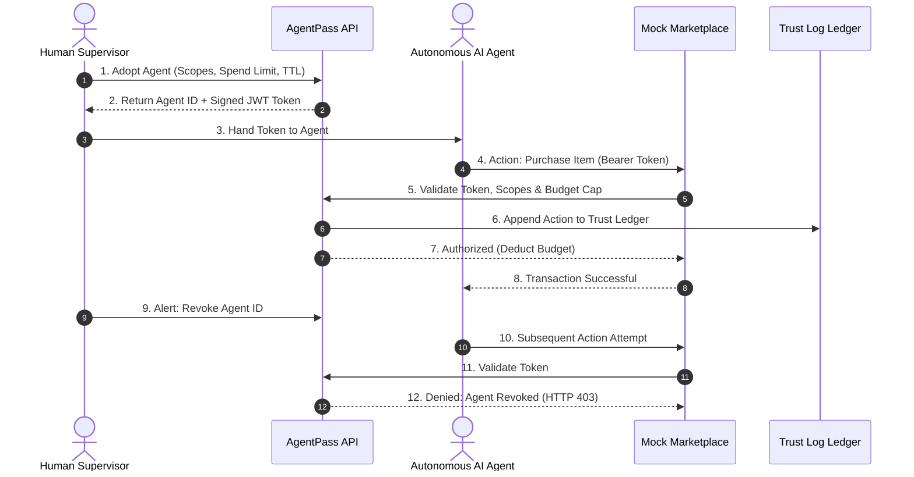

# AgentPass — AI Agent Identity & Trust Infrastructure

> **"Scoped Delegations. Instant Revocation. Verifiable Public Trust Logs for Autonomous AI."**

[](https://www.python.org/)
[](https://fastapi.tiangolo.com/)
[](https://jwt.io/)

AgentPass is an enterprise-grade identity, authorization, and audit infrastructure built for autonomous AI agents ("AI's First Day Online" — RIFT Hackathon). It solves the fundamental governance gap in autonomous agency: humans need to empower agents with operational capabilities (e.g. purchasing, negotiating, posting) without granting unrestricted credit cards or unrevokable keys. AgentPass issues time-delimited, scope-restricted, cryptographically signed JWT credentials backed by a public audit ledger and one-click instant revocation.

---

## 🚀 Key Features

1. **Human-to-Agent Identity Delegation**: Humans formally "adopt" an AI agent, generating scoped JWT credentials specifying exact permissible actions (`browse`, `purchase`, `negotiate`, `post`, `moderate`).
2. **Hard Budget Enforcement**: Establishes strict spend ceilings per agent session. Transactions exceeding remaining delegated budget limits are blocked deterministically.
3. **Time-To-Live (TTL) Automatic Expiration**: Tokens carry hard cryptographic expiration claims (`exp`), guaranteeing that rogue or orphaned agents cannot execute stale actions indefinitely.
4. **Transparent Public Trust Ledger**: Every action executed by an agent (successful or blocked) is permanently appended to an immutable audit log recording agent ID, scope, payload, timestamp, and status.
5. **Kill-Switch Instant Revocation**: Human supervisors can invalidate an agent's authority in real time. Subsequent API attempts with existing tokens fail with HTTP 403 Forbidden.
6. **Live Interactive Marketplace Simulator**: Demonstrates agent behaviors inside an e-commerce marketplace sandbox with interactive web UI (`index.html`) and automated simulation scripts (`demo_agent.py`).

---

## 🛠 Tech Stack

- **Framework**: FastAPI (Asynchronous ASGI server)
- **Security & Cryptography**: PyJWT (HS256 signed delegation claims), token authorization middleware
- **Data Persistence**: SQLite3 with thread-safe connection pooling
- **Language**: Python 3.10+
- **Frontend**: Clean single-page console (`index.html`) with live trust feed and agent inspector
- **Testing**: Pytest with FastAPI TestClient

---

## 🏗 Architecture & Directory Structure

```
RIFT-Hackathon-AgentPass/
├── tests/
│   └── test_agentpass.py     # Automated delegation, scope & audit unit tests
├── demo_agent.py             # Agent simulation script (happy path & over-budget failure)
├── index.html                # Interactive human supervisor dashboard & marketplace
├── main.py                   # FastAPI core, token verification & trust log endpoints
├── requirements.txt          # Python dependencies
├── .env.example              # Secret key and port configurations
├── .gitattributes            # Language definition rules
├── .gitignore                # Database and cache ignore patterns
├── LICENSE                   # MIT License
└── README.md                 # Project documentation
```

---

## 🔒 Security Architecture



---

## ⚡ Getting Started

### Prerequisites

- Python `3.10` or higher
- `pip` package manager

### Installation

1. Clone the repository:
   ```bash
   git clone https://github.com/chakriburidi237-crypto/RIFT-Hackathon-AgentPass.git
   cd RIFT-Hackathon-AgentPass
   ```

2. Create and activate a virtual environment:
   ```bash
   python -m venv venv
   # On Windows:
   .\venv\Scripts\activate
   # On macOS/Linux:
   source venv/bin/activate
   ```

3. Install dependencies:
   ```bash
   pip install -r requirements.txt
   ```

4. Launch the AgentPass API server:
   ```bash
   uvicorn main:app --reload --port 8000
   ```
   Open [http://localhost:8000](http://localhost:8000) or open `index.html` in your browser.

5. In a second terminal, execute the automated agent demonstration:
   ```bash
   python demo_agent.py
   ```

---

## 🧪 Automated Testing

Execute the test suite to verify token issuance, scope enforcement, and trust log operations:

```bash
pytest tests/ -v
```

Expected output:
```
tests/test_agentpass.py::test_catalog_retrieval PASSED
tests/test_agentpass.py::test_agent_registration_and_token_delegation PASSED
tests/test_agentpass.py::test_trust_log_audit PASSED
======================== 3 passed in 0.32s ========================
```

---

## 📄 License and Copyright\n\nAll rights reserved © 2026 Chakradhar Buridi.

